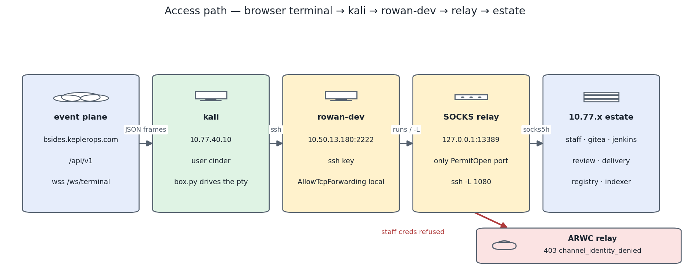

# BSides CTF 2026 — "Operation NORTHSTORM"

A complete write-up of the BSides CTF 2026 range: **what it was built from, how it was
networked, which accounts and services existed, and how each solved challenge was
actually done.** Written so someone with little experience can start at the top and
follow it down into the detail.

**Our result: 91 / 240 challenges, 10,700 points.**

| Category | Solved | Total | What it teaches |
|---|---|---|---|
| 1. Training | 16 | 16 | web app bugs, git history, SCADA semantics |
| 2. KeplerOps | 64 | 104 | source, CI, packages, cloud, identity, AI assistant |
| 3. ARWC | 11 | 120 | documents, OT/HMI, process data, delegation |

> **Read this first if you are here to learn:** most of this range was solved by AI agents
> driven by one human operator. The per-card files in [`writeups/`](writeups/README.md)
> are reconstructions from captured output, and some were written after the fact by a
> different agent — where that is true, the file says so. The parts written to teach you
> *how to think* are [`docs/00-start-here.md`](docs/00-start-here.md),
> [`docs/10-textbook/`](docs/10-textbook/README.md) and [`docs/20-labs.md`](docs/20-labs.md).
> Start there.

---

## This is a textbook, not a trophy case

The range was largely executed by AI agents under human direction, so "here is what we
scored" would teach you very little. The repo is therefore organised as a course: a loop
you repeat, a bug class per chapter, labs you build and break yourself, and the real cards
as case studies.

| Part | What it is | Start |
|---|---|---|
| **I** | The loop, the four tools, and one desk solved end-to-end by hand | [`docs/00-start-here.md`](docs/00-start-here.md) |
| **II–V** | Eleven chapters, one bug class each: *what it is → why it exists → how to spot → how to test → case study → fix → exercises* | [`docs/10-textbook/`](docs/10-textbook/README.md) |
| **Labs** | Rebuild each bug locally, break it, fix it (Flask + curl) | [`docs/20-labs.md`](docs/20-labs.md) |
| **Reference** | The range itself: topology, hosts, accounts, service accounts, trust boundaries | [`docs/02-network-topology.md`](docs/02-network-topology.md) · [`docs/04-accounts-and-hosts.md`](docs/04-accounts-and-hosts.md) |
| **Case files** | All 91 solved cards, one file each, same structure | [`writeups/`](writeups/README.md) |
| **Retrospective** | Attribution, hint spend, wrong attempts, dead ends, what we could not do | [`docs/06-caveats.md`](docs/06-caveats.md) |
| **For the next agent** | Repo state, unfinished work, gotchas, verification commands | [`HANDOVER.md`](HANDOVER.md) |
| **Run artefacts** | The live board, claims, flag registry, netmap, per-card evidence | [`ops/`](ops/README.md) · [`toolkit/`](toolkit/README.md) |

---

## The story

The event is a three-act narrative. You are a new operator for "Cinder Typhoon". A rival
outfit disrupted your operation; you are told to work your way into their supply chain.

- **Act 1 — Training.** Four desks on a small network teach the mechanics. They are
  deliberately simple: one bug each, one flag each.
- **Act 2 — KeplerOps.** A fictional software vendor that makes **FieldLink**, a connector
  that ships to customers. You get a foothold on a developer workstation (`rowan-dev`) and
  move through source control, CI, packaging, cloud, identity and an AI assistant.
- **Act 3 — ARWC.** The customer: **Alterra Regional Water Co.**, a water utility running a
  reservoir ("Cairn Reach") with PLC-controlled outlet gates, an HMI, and a process
  historian. This is the objective of the story, and the hardest wall in the event.

---

## The lab at a glance

Everything is one routed flat network with three segments and a single customer host.
There is no VPN profile — access is the platform's browser terminal.


*Three segments plus the customer relay. `kali` reaches the four training desks
directly; everything in the KeplerOps block is reached through `rowan-dev`; the ARWC
block answers only with a customer-issued channel identity.*



*The path an operator actually takes: browser terminal → Kali → SSH to the developer
workstation → SOCKS relay on its one permitted port → the 10.77.x estate. The same
relay is refused by the ARWC connector.*


### Machines

| Host | Address | Role | Open ports |
|---|---|---|---|
| kali | 10.77.40.10 | your operator box; tooling, pivot client, submissions | — |
| workbench.training | 10.77.40.20 | training desk 1 (git handover + 3 helper services) | 8080–8083 |
| accounts.training | 10.77.40.30 | training desk 2 (identity / recovery) | 8080 |
| developer.training | 10.77.40.40 | training desk 3 (artifacts, package consumer) | 8080–8083 |
| state.training | 10.77.40.50 | training desk 4 (practice tank / outlet) | 8080 |
| rowan-dev | 10.50.13.180 · 10.77.50.20 · 10.77.55.2 | developer workstation; **the pivot** | 2222 (sshd), 3389 (RDP), 8701 (local helper), 13389 (relay) |
| keplerops fabric | 10.77.50.11 | ~17 vhosted services on one IP | 443, 5432, 6443, 8443 |
| KDC | 10.77.50.40 | Kerberos realm `KEPLEROPS.TEST` | 88 |
| gitea | 10.77.51.20 | source control + client reference docs | 22, 443, 8443 |
| registry | 10.77.51.30 | package registry (npm-style) | 443, 8443 |
| jenkins | 10.77.51.40 | CI | 443 |
| review | 10.77.51.41 | isolated report/connector worker | 443 |
| preview / indexer | 10.77.51.50 / .70 | previews, document indexing | 443 |
| delivery | `delivery.keplerops.test` | inspections, releases, package metadata | 8443 |
| connector (ARWC) | 10.77.60.20 | the only ARWC host that exists | 443, 22 |

> ARWC is **one host**. Sweeping `10.77.60–70.0/24` found nothing else, so every ARWC
> challenge is about credentials and documents, not about reaching new machines.

---

## Getting in (and the one trick that matters)

1. **The range box is not reachable from the internet.** The only path is the platform's
   browser terminal — the socket behind the UI's "Terminal" tab:
   `wss://…/ws/terminal/provision.node.training-host%230/`, carrying JSON frames
   (`{"type":"input","data":"…"}`) into a real SSH pty. The tool `box.py` (see
   `docs/05`) speaks this, so everything is scriptable.
2. **From the box, SSH to the developer workstation**: `ssh rowan-dev` (user `rowan`,
   port `2222`, key `~/.ssh/keplerops-foothold`).
3. **The workstation's sshd refuses dynamic forwarding.** Its config is
   `AllowTcpForwarding local` + `PermitOpen 127.0.0.1:13389`. So `ssh -D` (a SOCKS proxy)
   dies with `channel 1: open failed: administratively prohibited`. The workaround — and
   this is the single most reusable lesson of the event:

   ```bash
   # on rowan-dev: a tiny SOCKS5 listener bound to the ONE permitted port
   nohup python3 socks5.py 13389 &
   # from the kali box: forward that port locally
   ssh -N -L 0.0.0.0:1080:127.0.0.1:13389 rowan-dev
   # now everything 10.77.x is reachable:
   curl -sS --socks5-hostname 127.0.0.1:1080 -k https://staff.keplerops.test/
   ```
4. **TLS inside the range** is signed by `CN=KeplerOps Range CA`, available on the
   workstation at `~/.local/share/keplerops/ca.crt`.

### Why the pivot has to be built that way

Worth understanding rather than copying, because this pattern shows up in real
environments:

- `ssh -D 1080` asks sshd to open **`direct-tcpip`** channels — one per destination the
  client names. `AllowTcpForwarding local` forbids exactly that, so every channel is
  refused server-side. The error is not a network error; it is an *authorization*
  decision made by sshd, which is why the socket connects and then dies.
- `PermitOpen 127.0.0.1:13389` then narrows even local forwarding to one destination
  triple. `ssh -L 1080:staff.keplerops.test:443` would be refused; `ssh -L
  1080:127.0.0.1:13389` is allowed because it matches the permitted pair.
- Therefore the only way to get general egress is to make the *permitted* port do the
  work: run a SOCKS5 listener on rowan-dev bound to `127.0.0.1:13389`, and forward that
  one port. The restriction is respected; the capability is regained.
- Consequence for tooling: everything downstream must speak SOCKS (`curl
  --socks5-hostname`, `proxychains`, `requests[socks]`), and DNS must resolve *through*
  the proxy — which is why `--socks5-hostname` (not `--socks5`) is used.

---

## Accounts and identities

Full detail in [`docs/04-accounts-and-hosts.md`](docs/04-accounts-and-hosts.md). Summary:

### OS users

| Account | Host | How you get it | What it gives |
|---|---|---|---|
| `cinder` | kali box | you start here | passwordless sudo, internet, tooling |
| `rowan` | rowan-dev | SSH key already on the box | workstation shell, `psql`, `kubectl`, `kinit`, AWS profile |
| `fieldkest-runner` | CI container | job context | run-time dir with `connections.env`, per-run credentials |

### KeplerOps application accounts

| Account | Where | Secret | Rights |
|---|---|---|---|
| `rowan.ito` | Gitea, Jenkins, review, delivery, npm, AnythingLLM, Keycloak, KDC | `fk_developer_…` (one string, many systems) | developer: 4 repos, CI read, report submit, package publish |
| `maya.ranscombe` | osTicket, Kanboard, AnythingLLM | password | support agent, project 1 tasks, LLM default role |
| `talia.mornac` / `talia.mornac-review` | osTicket | password / recovery token | reviewer queue, view-only on the ARWC diagnostic |
| `evan.calderoux@keplerops.test` | staff archive (mTLS) | cert minted on demand | own archive handover, delegation probe |

### Machine identities and service accounts

| Principal | Scope proven |
|---|---|
| `fk_support_rowan_…` bearer | `support:8443` — handovers, create customer diagnostics, read/deliver jobs |
| `fk_cert_enrollment_…` worker | `POST /api/enrollment/StaffArchiveUser/requests` only |
| `svc-fieldlink-workload` (k8s JWT) | `get` on two ConfigMaps in ns `fieldlink`; no secrets/pods |
| `svc-fieldlink-export` (role exchange) | `/api/exports/EXP-2841`, `/api/schedules/SCHED-2841`, export ConfigMaps |
| `svc-fieldlink-ci` (per-run) | `GET /api/build-records/worker-status` |
| `fieldkest-runner` container | runner diagnostics as the CI worker |
| `fieldlink` @ ARWC | maintenance SSH key named in a delivery receipt (never used) |

### Database, PKI, Kerberos, tenants

| Item | Detail |
|---|---|
| Postgres | `data.keplerops.test:5432`, db `fieldlink_data`, role `rowan_data` → only `export.partition_bindings` |
| Hidden schemas | `support.customer_records`, `support.customer_migration_history` owned by `fieldlink_admin` / `fieldlink_data_owner` — never recovered |
| CA | `CN=KeplerOps Range CA`; step-ca at `ca.keplerops.test` |
| Enrollment | template `StaffArchiveUser`, `eku=clientAuth`, `subject_format={subject}` — mints a cert **and its private key** for **any** `@keplerops.test` UPN. The only validation is that the string looks like a realm UPN (`422 invalid_upn` otherwise). This makes the certificate subject an attacker-controlled claim: the archive enforces `cert.subject == handover.subject`, so you enroll as the colleague you want to read. |
| Kerberos | realm `KEPLEROPS.TEST`, KDC `10.77.50.40`; only SPN that exists: `HTTP/staff.keplerops.test` |
| Tenants | `TEN-ARWC-047` (asset `CRR-OG2`, connector `FLK-7.4.2`), `TEN-RILL-022` (asset `RILL-PUMP-442`) |

---

## Services you will meet

| Service | What it is | Why it matters |
|---|---|---|
| `source.keplerops.test` | Gitea | repos, issues used as handovers, API for file contents at a revision |
| `ci.keplerops.test` | Jenkins | `fieldlink-report` build 1842, `fieldlink-report-review` accepts `provider.zip` |
| `review.keplerops.test` | isolated report worker | runs submitted code in a sandbox and returns the report |
| `delivery.keplerops.test:8443` | release/inspection service | package metadata, inspections, entitlements, approvals |
| `support.keplerops.test` | osTicket (`/scp/`) + support client (`:8443`) | tickets, and scoped customer diagnostic jobs |
| `staff.keplerops.test` | directory + archive + enrollment | client-cert issuance, archive handovers, delegation |
| `objects.keplerops.test` | S3-compatible | `fieldkest-workspaces` listable anonymously |
| `cloud-api.keplerops.test:6443` | Kubernetes | token exchange, schedules, jobs |
| `assistant.keplerops.test` | AnythingLLM + local Ollama | workspaces, contexts, prompt handling |
| `workboard.keplerops.test` | Kanboard | project 1 "FieldLink release operations" |
| `connector.arwc.test` | FieldKest Customer Relay | the ARWC wall — 403 `channel_identity_denied` without an ARWC channel identity |

Every one of these publishes its own contract at `/.well-known/fieldkest-client`,
listing routes and request bodies. **Finding those documents was the single biggest
time-saver of the event** — it replaces guessing with reading.

---

## Trust boundaries — the analytical core of the event

Most cards are one of four boundary violations. Naming the boundary first is what makes
the rest of the range predictable:

| Boundary | What is supposed to stop you | What actually stops you (or doesn't) |
|---|---|---|
| **Object ownership** | the endpoint checks the caller owns the object | often only checks *authentication*, not *authorization* → IDOR (T02.4, K14.2) |
| **Identity issuance** | only the CA may assert an identity, per its policy | the CA signs any subject you request → mTLS becomes an assertion you control (K19.1/K19.2) |
| **Delegation scope** | a delegated credential is bound to one target, one audience, one duration | the delegation endpoint will mint a ticket for the SPN you ask for (K19.3) |
| **Tenant isolation** | data is partitioned by tenant id and the partition is enforced server-side | the partition id is caller-supplied and trusted (K15.2, K25.2) |

Two more that recur:

- **Build/执行 boundary** — code you submit is supposed to be sandboxed and only produce
  data. The interesting failures are where the sandbox keeps a *usable* credential or a
  readable source tree (K02.3, K09.x).
- **Channel identity** — a customer-facing relay is supposed to accept only *that
  customer's* machine identity. All staff credentials are irrelevant by design. This is
  the wall in Act 3, and it is correct behaviour, not a bug.

---

## How the challenges work

- 240 cards across 3 categories, in numbered chapters (`T01.1`, `K07.3`, `W22.4`).
- Within a chapter, cards escalate: first is usually 50-point recon, last is 400–800
  points of chaining.
- Flag format `FLAG{<16 hex>}`.
- Wrong submissions trigger a cooldown (`attempt_limit_mode: lockout`, 300 s) — guessing is
  actively bad.
- Hints cost 10/20/30 points **permanently deducted from that card**, so a hinted 50-point
  card can pay 20.

---

## What we solved, and the techniques involved

Full table: [`docs/03-solved-challenges.md`](docs/03-solved-challenges.md). Per-card
detail: [`writeups/`](writeups/README.md). The technique index:

| Technique | Where it shows up |
|---|---|
| Path traversal in a render helper | T01.4 |
| User enumeration by response code/length | T02.1 |
| Sensitive endpoint with no visibility filter | T02.2 |
| Account takeover via recovery flow | T02.3 |
| IDOR (missing object-level authz) | T02.4 |
| Deleted content recovered from git history | T01.1, T03.1 |
| Install-hook analysis without installing | T03.3 |
| Building a provider package to a documented contract | T03.4, K02.3 |
| SCADA: measurement vs setpoint, status-word bit decode | T04.1, T04.2 |
| Bounded actuation verified from observations | T04.3 |
| Log-vs-report reconciliation | T04.4 |
| Credential harvesting from dotfiles (`~/.npmrc`, `~/.gitconfig`, `~/.pgpass`) | K01.1 |
| Browser profile / session recovery | K01.2 |
| Internal work-board and artifact correlation | K01.3, K02.1 |
| Package manifest/version confusion | K05.1, K05.2 |
| CI runner source leak → flag constants | K09.1–K09.4, K29.4 |
| Kubernetes/workspace token exchange | K13, K14, K15 |
| Client-certificate enrollment for an arbitrary subject → mTLS | K19.1, K19.2 |
| Kerberos delegation probe returning a credential cache | K19.3 |
| LLM context/workspace and prompt-injection data exposure | K21, K23 |
| Support delegation re-pointed at another reviewer | K17.1–K17.3 |
| Customer documents / inspections / package metadata | W01–W03, W13, W14, W19, W31 |

### Where we got stuck (honestly)

The ARWC relay is the wall, and it is worth being precise about *why*: it answers `404
route_not_found` to unknown paths and `403 channel_identity_denied` to the five real
routes (`packages/poll`, `packages/{v}/activate`, `packages/{v}/receipt`,
`rehearsals/rollback`, `diagnostics`) unless you present an **ARWC-issued** machine
identity. We proved that all the nearby credentials are the *wrong kind*: staff mTLS
certs (including one minted for `evan.calderoux`), the delegated Kerberos ccache, and
KeplerOps service tokens all return the same 403. The KDC also has exactly one SPN
(`HTTP/staff.keplerops.test`), so you cannot request a useful service ticket for the
relay. And the customer tables that would hold the integration record
(`support.customer_records`, `support.customer_migration_history`) are owned by a
database role (`fieldlink_admin`) we never obtained.

That is why ARWC sat at 11/120 while KeplerOps reached 64/104: the remaining ARWC cards
are not harder exploitation, they are gated behind an identity we could not legitimately
become.

---

## How the work was driven

Everything ran from one script driver over the browser terminal, plus a fleet of headless
agents — each bound to one chapter, with a shared claim board so two agents never fought
over the same card. Details, diagrams and gotchas in
[`docs/05-method-and-tooling.md`](docs/05-method-and-tooling.md).

---

## Glossary

| Term | Meaning |
|---|---|
| **IDOR** | Insecure Direct Object Reference — an endpoint that takes an object id and never checks you own it |
| **mTLS** | mutual TLS; both sides present certificates, so the server can identify the client |
| **UPN** | user principal name, `user@realm` |
| **SPN** | service principal name in Kerberos, `HTTP/host@REALM` |
| **ccache** | a Kerberos credential cache file, produced by `kinit` or a delegation exchange |
| **SOCKS5** | a generic TCP proxy protocol; `--socks5-hostname` also resolves DNS remotely |
| **JWT** | signed JSON token used for API auth; scopes are claims inside it |
| **SCADA / OT** | industrial control systems; PLCs, HMIs, historians |
| **OPC UA** | industrial protocol (`opc.tcp://…:4840`), node-addressed tag tree |
| **Historian** | time-series store of process values (`ot_history.process_samples`) |
| **Path traversal** | `../` in a filesystem path parameter escaping the intended directory |
| **Annex / handover** | the in-story names for documents passing between supplier and customer |

---

## Caveats

Attribution, hint spend (42 hints / 770 points forfeited), ~426 wrong attempts, two flags
found but never attributed, and the full list of dead ends: [`docs/06-caveats.md`](docs/06-caveats.md).

All credentials in this repo existed only inside the exercise range, which has been
destroyed. They are published for study, not for reuse.
