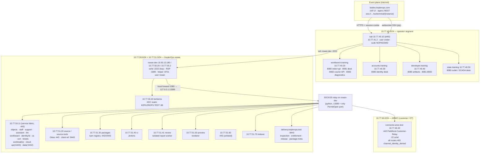

# Network topology

Three routed segments plus a customer relay. Everything hangs off one Kali
workstation; there is no VPN file (`vpn_profile_available: false` on the event
API), so access is the browser SSH terminal and then one SSH hop.

## Diagram

## The access path, in words

1. `wss://bsides.keplerops.com/ws/terminal/provision.node.training-host%230/` — the
   same socket the UI's "Terminal" tab uses. JSON frames
   (`{"type":"input","data":"..."}`) are piped into a real SSH pty on the Kali box.
   `box.py` speaks this, so the whole run is scriptable without a browser.
2. From the Kali box: `ssh rowan-dev` (host block in `~/.ssh/config`, user `rowan`,
   port `2222`, key `~/.ssh/keplerops-foothold`).
3. rowan-dev's sshd is locked down: `AllowTcpForwarding local` and
   `PermitOpen 127.0.0.1:13389`. So `ssh -D` (dynamic SOCKS) is refused — every
   `direct-tcpip` channel dies with `administratively prohibited`. The workaround is
   a SOCKS5 listener **on rowan-dev** bound to 13389, plus `ssh -N -L 0.0.0.0:1080:127.0.0.1:13389`
   from the Kali box. That gives every lane a working proxy at `127.0.0.1:1080`.
4. TLS inside KeplerOps is signed by `CN=KeplerOps Range CA`; the cert is at
   `/home/rowan/.local/share/keplerops/ca.crt` and was copied out to `ca.crt`.

## Hosts and exposed ports (probed, not guessed)

| Address | Ports | Role |
|---|---|---|
| 10.77.40.10 | — | operator Kali box (`cinder`), egress + tooling |
| 10.77.40.20 | 8080–8083 | `workbench.training` — index/git, dispatch desk, courier API, diagnostics helper |
| 10.77.40.30 | 8080 | `accounts.training` — identity desk (recovery, directory, assignments) |
| 10.77.40.40 | 8080–8083 | `developer.training` — artifacts, package registry, consumer |
| 10.77.40.50 | 8080 | `state.training` — outlet/SCADA practice tank |
| 10.50.13.180 | 22, 3389 | rowan-dev; sshd on **2222** is the published one |
| 10.50.13.181 | 22 | second sshd in the same /24 (unused by the story) |
| 10.77.50.11 | 443, 5432, 6443, 8443 | ~17 vhosted services, Postgres, Kubernetes API |
| 10.77.50.20 | 22 | rowan-dev's internal address (same host as 10.50.13.180) |
| 10.77.50.40 | 88 | MIT Kerberos KDC, realm `KEPLEROPS.TEST` |
| 10.77.51.20 | 22, 443, 8443 | Gitea + client reference |
| 10.77.51.30 | 443, 8443 | npm-style package registry |
| 10.77.51.40 | 443 | Jenkins |
| 10.77.51.41 | 443 | isolated report worker |
| 10.77.51.50 | 443 | preview renderer |
| 10.77.51.60 | 443 | host present, no name in `/etc/hosts` |
| 10.77.51.70 | 443 | indexer |
| 10.77.55.2 | 22 | rowan-dev on its "management" /29 |
| 10.77.60.20 | 22, 443 | `connector.arwc.test` — the only ARWC host that exists |

> Only `10.77.60.20` responds on the entire ARWC range. A sweep of
> `10.77.60–70.0/24` on 20+ ports found nothing else, so "ARWC" is a single relay
> host — which is why every W-challenge is really about credentials and documents
> rather than about reaching new machines.

## Service vhosts on 10.77.50.11

| vhost | What it is |
|---|---|
| `objects.keplerops.test` | S3-compatible store; `fieldkest-workspaces` listable anonymously |
| `data.keplerops.test` | PostgreSQL: `fieldlink_data` (+ `fieldlink_identity`, `fieldlink_staff` behind pg_hba) |
| `cloud-api.keplerops.test:6443` | Kubernetes API, context/namespace `fieldlink` |
| `staff.keplerops.test` | directory, archive handovers, enrollment, delegation, managed identities |
| `support.keplerops.test` | osTicket at `/scp/` (443) and the FieldKest support client at `:8443` |
| `assistant.keplerops.test` | AnythingLLM (local Ollama at `llm.keplerops.test`) |
| `workboard.keplerops.test` | Kanboard, project 1 "FieldLink release operations" |
| `identity.keplerops.test` / `id.keplerops.test` | Keycloak, realm `keplerops` |
| `ca.keplerops.test` / `cert.keplerops.test` | Smallstep step-ca + a small enrollment front (`/health` only) |
| `workload.keplerops.test` / `workloads.keplerops.test` | job/workload runner |
| `tickets.keplerops.test` | ticket front-end |

## Client references (the map that unlocked the last stretch)

Each service publishes its own contract at `/.well-known/fieldkest-client`. Those
documents enumerate every route with request bodies — the single most useful find
of the whole event:

- `source-tools…:8443` → repos, handover issues, policy compiler evaluations, connector archive runs
- `delivery…:8443` → package metadata, publish, consumer checks, releases, **inspections**, entitlements, approvals
- `support…` → handover/current, `POST /api/customers/{tenant}/diagnostics`, `GET/PUT/POST /api/diagnostics/{job}[/package|/deliver]`
- `review…` → report submit/read, connector review, CI runs + artifacts

## Why the layout matters

The estate is deliberately shaped so that the *interesting* boundary is not a
firewall but a **credential**: the ARWC relay answers 404 to every path and 403
`channel_identity_denied` to every authenticated attempt unless you present an
ARWC-issued channel identity. Staff mTLS certificates, staff Kerberos tickets and
KeplerOps service tokens are all explicitly *insufficient* — which is the lesson
the ARWC category is built around, and the wall our run did not get past.
