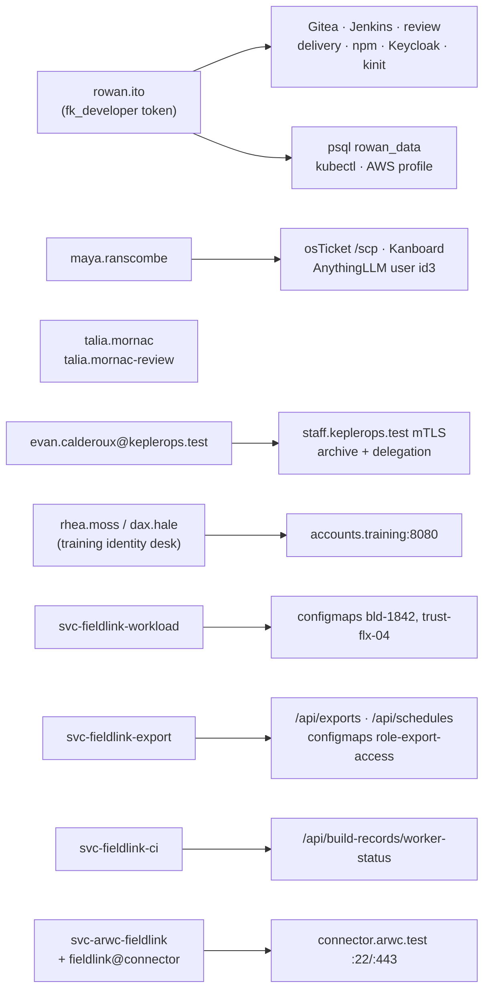

# Accounts, identities and hosts

Every identity recovered during the run, what it was valid for, and where it was found.
Host/port topology lives in [02-network-topology.md](02-network-topology.md); this page binds
identities to hosts and services.

All names are CTF fixtures (`rowan.ito`, `maya.ranscombe`, ARWC tenant IDs) and nothing is
redacted: these values existed only inside the exercise range. **Every row below is
`range-only, environment destroyed`** — the estate was torn down after the event. "Found"
cites the operator notes (`NETMAP`, `HANDOVER`) or a lane report under `/home/kali/ctf/lanes/`.

## Identity → service map

## 1. OS / workstation accounts

| Account | Host | Material | Where found | Valid for | State |
|---|---|---|---|---|---|
| `cinder` (uid 2000) | range box `kali`, 10.77.40.10 | passwordless sudo; driven over the platform terminal WebSocket | `HANDOVER` §2 | every attack, SOCKS pivot client, submissions | range-only, environment destroyed |
| `rowan` (uid 2000) | `rowan-dev` — 10.50.13.180:2222, 10.77.50.20, 10.77.55.2 | SSH key `~/.ssh/keplerops-foothold`; RDP password `fieldlink-dev-2841` | `HANDOVER` §2, `NETMAP` | workstation shell, pivot relay on :13389, `psql`, `kubectl`, `kinit`, AWS profile | range-only, environment destroyed |
| `fieldkest-runner` (uid 999) | container `fieldlink-review` | none — job context only; per-run dir `$FIELDLINK_RUN_DIR` = `/tmp/fk-run-RJ-…/fieldlink-ci` holding `connections.env`, `build-records.curl` | `k09/REPORT.md` | running `runner-command` diagnostics as the CI worker | range-only, environment destroyed |
| `fieldlink` | `connector.arwc.test` :22 (10.77.60.20) | `maintenance_access` SSH key named in the diagnostics deliver receipt (key material not recorded) | `micro/w03b/REPORT.md` | ARWC maintenance access (never exercised) | range-only, environment destroyed |
| `rhea.moss` | `accounts.training:8080` (10.77.40.30) | recovery inputs `CASE-7Q4M` + `Blue cabinet 17`; session `CINDER_REHEARSAL_SESSION=VfVypNdOCy9v3nxKTpivD0xJWsyKfkEfWE2o3uOdC-c` | `t02/REPORT.md` | `/api/handover`, `/api/assignments`, `/api/assignments/{id}/brief` | range-only, environment destroyed |
| `dax.hale` | `accounts.training:8080` | none — referenced only as owner of dispatch assignment `ASG-317` | `t02/REPORT.md` | never authenticated (IDOR target through rhea's session) | range-only, environment destroyed |
| `mina.cho`, `owen.pike` | `accounts.training:8080` | none — lookups return `410 inactive` and `404 unknown` | `t02/REPORT.md` | nothing | range-only, environment destroyed |

`rowan` has **no** sudo on rowan-dev (passwordless sudo is the range box only, `k21`); training sessions came from one-time recovery redemption.

## 2. KeplerOps application accounts

| Account | Application | Secret | Where found | Effective rights | State |
|---|---|---|---|---|---|
| `rowan.ito` | Gitea, Jenkins, `review.keplerops.test` basic auth, `delivery:8443` basic auth, npm registry, AnythingLLM (user id 2), Keycloak `admin-cli`, Kerberos `kinit` | `fk_developer_yUWTKSqrc16y3K5_5DfQ7qacft9b-9xo` — the same string is the password for web UI, Keycloak grant and KDC | `NETMAP`, `k21/notes.md` | developer: 4 Gitea repos, Jenkins read/artifacts (no Job/Configure), report review submit, npm pack | range-only, environment destroyed |
| `maya.ranscombe` | osTicket `/scp/` agent, Kanboard `workboard` (user id 3), AnythingLLM (user id 3), owner of export `EXP-2841` and destination `EXP-2841-maya` | `sWQa31085FTQekZhHTxUyf_9E1marq0ur8WNCKmTtnk` | `NETMAP`, `k17`, `k21`, `k25` | support agent views, project 1 tasks, default-role LLM workspaces | range-only, environment destroyed |
| `talia.mornac` | osTicket `/scp/` (agent, reviewer-ops) | `K17r3v13wTalia2841` | `k17/REPORT.md`, `k22/NETMAP.md` | reviewer ticket queue | range-only, environment destroyed |
| `talia.mornac-review` | osTicket reviewer account, role "Support reviewer — view only" | recovery token `k17-talia-mornac-review-token-2841` via `/scp/pwreset.php?token=`; password later changed to `K17r3v13wTalia2841` | `k17/REPORT.md` (REV-2841), `k22/NETMAP.md` | view-only reviewer on `DIAG-CRR-MIXED-19` / CRR-OG2 | range-only, environment destroyed |
| `evan.calderoux@keplerops.test` | `staff.keplerops.test` mTLS identity | certificate + private key minted by the StaffArchiveUser enrollment template | `ARWC-FINDINGS.md`, `k17/notes.md` | `/api/archive/handovers/evan.calderoux…`, `POST /api/archive/delegation/probe` | range-only, environment destroyed |

Notes that matter for reuse:

* **AnythingLLM (1.19.0)**: users `id2 rowan.ito`, `id3 maya.ranscombe`, both role `default`;
  no admin/manager was found (`admin:admin` failed) — workspace update, `system/api-keys` and
  `workspace-chats` are 401 for that role (`k21`, `k23`).
* **Keycloak** realm `keplerops` (`identity`/`id.keplerops.test`; realms `master` + `keplerops`
  only). `client_id=admin-cli` password grant works for `rowan.ito` but yields only
  `email profile` — no realm admin. `OIDC-FIELDKEST-SUPPORT` is registered but unusable with
  direct grants (`w05`, `k21`).
* **osTicket ticket IDs**: 1 `SUP-2841` (ARWC callback latency), 2 `SUP-2819` (Riverbend),
  3 `SUP-2834` (North Quay), 4 `SUP-2850` (Marshgate), 5 `ESC-2841`, 6 `REV-2841` (ARWC case
  reviewer assignment) — `k17/REPORT.md`.
* `GET /api/service-directory` (basic `rowan.ito`) returns the staff identity binding:
  `archive_subject evan.calderoux@keplerops.test`, `enrollment_worker fk_cert_enrollment_…`,
  `restricted_note NOTE-SUP-2841-7`, `support_registration OIDC-FIELDKEST-SUPPORT`.

## 3. Service tokens and machine identities

| Token / principal | Issued or found | Scope actually proven | Where found | State |
|---|---|---|---|---|
| `fk_support_rowan_2fxtXNkUjKMbcvPBlAot0Jp0vVNppL9b` (principal `rowan.ito`) | `~/.config/fieldlink/support-client.json`; also a `fieldkest_support` cookie in rowan's Chromium profile | `support:8443` Bearer (handovers, diagnostics) **and** the assistant overlay session cookie | `NETMAP`, `k21`, `k23` | range-only, environment destroyed |
| `fk_cert_enrollment_Um9U1sNZQ5b_Cb08iirD4H-BKfz8aMF9` (enrollment worker) | `GET /api/service-directory` | `POST /api/enrollment/StaffArchiveUser/requests` only; any other use ⇒ `401 enrollment_worker_required` | `k17`, `ARWC-FINDINGS.md` | range-only, environment destroyed |
| `fk_workload_fixture_7nNUHpIQRCb5s2SLo7lb0sJH9LXByeMK` | `GET /api/workspaces/current/token-exchange` (basic rowan) | exchange fixture only — not accepted as a bearer anywhere | `k13`, `micro/w05a` | range-only, environment destroyed |
| `svc-fieldlink-workload` k8s JWT | `POST /api/workspaces/current/token-exchange` `{}`; TTL 3600 s | `get` on ConfigMaps `bld-1842` and `trust-flx-04` in ns `fieldlink`, plus SSRR/SSAR; no secrets/pods/jobs | `k13/REPORT.md` | range-only, environment destroyed |
| `svc-fieldlink-export` JWT, role `role/support-export-editor`, aud `fieldkest-export-access` | `POST /api/token-exchange/fieldkest-export-access` with the workload JWT | `/api/exports/EXP-2841[/definition]`, `/api/schedules/SCHED-2841`, configmaps `role-export-access`, `exp-2841-definition`, cronjob `sched-2841`; not `/api/exports` list, not objects STS | `HANDOVER` §8, `k14`, `k15` | range-only, environment destroyed |
| `release-reader` role token (principal `svc-fieldlink-export`) | role exchange | rejected by delivery (`release-reader` insufficient) | `k08/notes.md` | range-only, environment destroyed |
| `svc-fieldlink-ci` build-records bearer | generated per review job in `$FIELDLINK_RUN_DIR/build-records.curl`, `aud=fieldkest-build-records`, ~3 min life | `GET /api/build-records/worker-status` only | `k09/REPORT.md` | range-only, environment destroyed |
| kubeconfig SA token, ns `fieldlink` | `/home/rowan/.kube/config` | `kubectl` on rowan-dev; SA `fieldlink:rowan-workspace` can only self-review — no cluster-wide list, no secrets | `NETMAP`, `k23`, `w05` | range-only, environment destroyed |
| `sched-2841-runner-credentials` → `STARTUP_TOKEN`, `HANDOVER_TOKEN` | secretRef on cronjob `sched-2841`, runs as `svc-schedule-runner` | **never read** — denied to the export JWT and to `rowan-workspace` | `HANDOVER` §8 (K16.3/16.4) | range-only, environment destroyed |
| `cred-completion-handover` (principal `svc-assistant-completion`) | assistant completion record `COMP-JOB-17`, handover `HANDOVER-COMP-2841` | completion token path only; not a usable credential | `k21`, `k23` | range-only, environment destroyed |
| npm `_auth` (`//packages.keplerops.test/:_auth`, base64 `rowan.ito:fk_developer_…`) | `~/.npmrc` on rowan-dev | `npm pack`/install of `@keplerops/*`; `@keplerops/support-rehearsal` is 403 for this user | `NETMAP`, `micro/w03b`, `micro/w05a` | range-only, environment destroyed |
| AWS profile `default` + CA bundle | `~/.aws` on rowan-dev | `s3://fieldlink-exports/backups/company-history.dump` readable; `fieldkest-exports` denied; STS rejects k8s JWTs (`no identity provider registered for issuer`) | `k15`, `HANDOVER` §8 | range-only, environment destroyed |

Two decoys worth recording: the `workspace_token` values inside `fieldkest-workspaces`
objects (`exports/EXP-2841/handover.json`, `notebooks/deploy-2026-09.json`) are **challenge
flags, not credentials** — STS rejects them (`k13`). The ARWC relay's **channel identity was
never recovered**: staff mTLS certs and the delegated ccache both return
`403 channel_identity_denied` (`ARWC-FINDINGS.md`).

## 4. Database roles

`psql service=fieldlink` on rowan-dev resolves to `data.keplerops.test:5432`, db
`fieldlink_data` (`~/.pg_service.conf` / `~/.pgpass`).

| Role | Secret | Grants proven | Where found | State |
|---|---|---|---|---|
| `rowan_data` @ `fieldlink_data` | `lobf9Jt0SBW433in6wUVlkixnQreh5K-Z1LjbTofrqY` | `SELECT` on `export.partition_bindings` only | `NETMAP`, `k15` | range-only, environment destroyed |
| `support` schema owner `fieldlink_admin` | not recovered | owns `support.customer_records`, `support.customer_migration_history` | `ARWC-FINDINGS.md` | range-only, environment destroyed |
| `fieldlink_data_owner` | not recovered | named owner of the support data; credential never located | `ARWC-FINDINGS.md` | range-only, environment destroyed |
| `fieldlink_identity`, `fieldlink_staff` DBs | — | exist on the same server; `rowan_data` denied by `pg_hba` | `w05/REPORT.md` | range-only, environment destroyed |

## 5. PKI and Kerberos identities

| Identity / object | Type | Material | Where found | Valid for | State |
|---|---|---|---|---|---|
| KeplerOps Range CA | X.509 CA, `CN=KeplerOps Range CA` | `/home/kali/ctf/ca.crt`; workstation copy `/home/rowan/.local/share/keplerops/ca.crt` | `NETMAP`, `k09` | verifying every `*.keplerops.test` TLS listener | range-only, environment destroyed |
| `fieldkest-enrollment` provisioner / template `StaffArchiveUser` | staff client-cert enrollment (`eku=clientAuth`, `subject_format={subject}`) | `POST /api/enrollment/StaffArchiveUser/requests`, body `{"upn":"<user>@keplerops.test"}` — returns `certificate_pem` + `private_key_pem` | `k17`, `ARWC-FINDINGS.md` | minting mTLS identities for the staff archive API | range-only, environment destroyed |
| `evan.calderoux@keplerops.test` | enrolled mTLS client identity | keypair at `/home/rowan/work/certificates/evan.calderoux.{crt,key}` | `k17/notes.md` | `GET /api/archive/handovers/<upn>` (only this subject), `POST /api/archive/delegation/probe` | range-only, environment destroyed |
| `rowan.ito@keplerops.test` | enrolled mTLS client identity | keypair at `/home/rowan/work/certificates/rowan.ito.{crt,key}` | `k17/notes.md` | enrollment proof; archive subject mismatch | range-only, environment destroyed |
| `rowan.ito` @ realm `KEPLEROPS.TEST` | Kerberos principal | `kinit` with the fk_developer token as password; KDC `kerberos.keplerops.test` (10.77.50.40) | `k21/REPORT.md` | TGT for `POST /api/managed-identities/{svc}/session` (SPNEGO), which still answers `managed_identity_denied` | range-only, environment destroyed |
| `HTTP/staff.keplerops.test@KEPLEROPS.TEST` | Kerberos SPN / service ticket | ccache `/home/rowan/work/krb5cc_evan` (base64 blob from the delegation probe) | `ARWC-FINDINGS.md`, `k17/notes.md` | `klist` shows a staff-only service ticket; SPNEGO to the ARWC relay is denied | range-only, environment destroyed |

Boundaries that held: any UPN outside `@keplerops.test` returns `422 {"error":"invalid_upn"}`;
the delegation probe answers `{"error":"ticket_request_failed"}` for `HTTP/connector.arwc.test`,
`HTTP/cloud-api.keplerops.test` and `HTTP/workloads.keplerops.test`. `ca.keplerops.test` is a
step-ca (health 200) but the enrollment token is not a step JWS, so `step ca certificate
--token` fails; `cert.keplerops.test` exposes `/health` only.

## 6. ARWC tenants, assets and records

| Tenant | Customer / asset | Connector revision | Records seen | Where found | State |
|---|---|---|---|---|---|
| `TEN-ARWC-047` | Alterra Regional Water Company, asset `CRR-OG2` | `FLK-7.4.2` (only binding accepted; `7.4.3-cinder.rset1` is the pending release) | `SUP-2841`, `CUSTREC-047-R6`, `PART-ARWC-01`, `DIAG-CRR-MIXED-19`, `MTN-CRR-204`, `ATT-DIAG-698` | `ARWC-FINDINGS.md`, `micro/w03b`, `k15`, `k21` | range-only, environment destroyed |
| `TEN-ARWC-019` | ARWC legacy FieldLink install | `FLK-6.9.8` | `REL-FLK-6.9.8-ARCHIVE`, `ENT-ARWC-DIAG-0698`, and the migration row "ARWC FieldLink legacy … → TEN-ARWC-047 / FLK-7.4.2" (2026-02-17) in the `support.customer_migration_history` dump | `HANDOVER` §8 (K15.4), `k25`, `micro/w03b` | range-only, environment destroyed |
| `TEN-OTHER-001` | unnamed non-current partition | `FLK-7.3.1` | `PART-ARWC-02`, rev 5, `is_current=f` | `k15`, `k25` | range-only, environment destroyed |
| `TEN-RILL-022` | Rillhaven, asset `RILL-PUMP-442` | `FLK-7.4.1-RILL` | `DOC-RILL-442`, `CONV-RILL-442-8`, `DIAG-RILL-MIX-08`, context `ctx-rill-support-v3` | `k21`, `k23` | range-only, environment destroyed |

Supporting identities: the ARWC account record names the customer "Alterra Regional Water
Company", maintenance case `MTN-CRR-204`, runtime identity `svc-arwc-fieldlink` and SSH
account `fieldlink@connector.arwc.test` (`micro/w03b`); `CRR-OG2` is also the `asset_id` in
the report fixture and diagnostics consumer request
(`{"asset_id":"CRR-OG2", …, "tenant_id":"TEN-ARWC-047"}`). ARWC has exactly one reachable
host, `connector.arwc.test` 10.77.60.20 (`:22`, `:443`); no ARWC DNS zone exists beyond that
static name and no ARWC-side user store was reached.

**Documented inconsistency (do not "fix" it):** the `export.partition_bindings` row for
`EXP-2841` says `TEN-ARWC-019 / PART-ARWC-01 / FLK-7.4.2 / rev 6 / is_current=t`, while the
export definition and retained customer record use `TEN-ARWC-047`. Both readings are live
captures (`k15`, `k25`); the database was never updated to match the migration row.

## 7. Identities that were never recovered

| Missing identity | Consequence |
|---|---|
| ARWC relay **channel identity** (ARWC-issued cert or token) | all `connector.arwc.test` routes 403; the delivery/support `:8443` routes are the working ARWC ingress |
| `fieldlink_admin` / `fieldlink_data_owner` DB credential | support schema, customer records and migration history unreadable |
| Keycloak realm admin | admin REST, user list and "activation roster" unreachable |
| AnythingLLM admin/manager | workspace update and agent-tool calls 401 |
| `sched-2841-runner-credentials` secret values | K16.3/K16.4 execution context never entered |
| 10.77.51.60 integration token | the unlisted `FieldKest/1.0` service accepts the support bearer but its routes stayed `404` |
| Mira Vale temporary account + approved assignment | W05's starter pack was never located |
