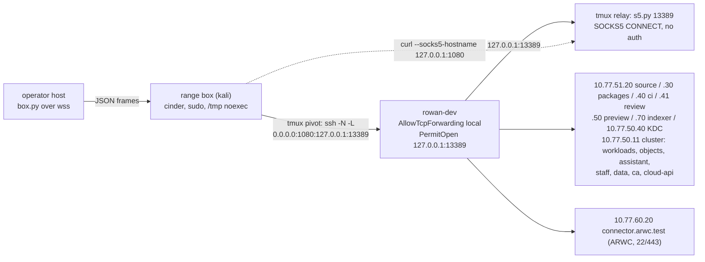

# 05 — Method and tooling

How the run was driven, how the range was reached, and the techniques that produced
accepted flags. Registry at the end of the run: **50 / 240 solved, 3450 pts**, with solved
state owned by the event API (local files are only caches).

## 1. Reaching the range: browser terminal → `box.py`

The Kali range box is **not directly reachable**. The only path in is the platform's
browser terminal — the same SSH session the UI "Terminal" tab opens:

```
wss://bsides.keplerops.com/ws/terminal/provision.node.training-host%230/
in:  {"type":"input","data":"..."} | {"type":"resize","cols":..,"rows":..}
out: {"type":"output","data":"..."}
```

`box.py` wraps that socket: loads the Django session cookie jar (`cookies.txt`), sends
`Cookie` + `Origin`, connects with retry (transient DNS/proxy blips), sends `resize` plus
a newline to wake the pty, drains the banner, types the command, and appends a sentinel
echo (`DONEMARK_<ms>$((6*7))` — a shell substitution, so the typed literal never matches
the output) to detect end-of-output; ANSI is stripped.

```bash
./box.py 'id; ls ~'          # ~8 s round trip, fresh shell every call
./box.py -t 90 'nmap -sT 10.77.40.20'
./box.py -f script.sh        # base64 heredoc upload -> `bash /tmp/script.sh`
```

No cwd, env or background process survives a call, so work was batched into one script
(`-f`) or parked in **tmux on the box**. Box facts: user `cinder`, passwordless sudo,
internet, `/tmp` **noexec** (`bash /tmp/x.sh`); `ss`, `netstat`, `setsid`, `ffuf`,
`sqlmap`, `gcc` absent; tooling is installed on the box, not the operator host.

## 2. The pivot, and the forwarding constraint

The box cannot route to `10.77.0.0/16`. `rowan-dev` is the only jump host and its sshd is
narrow: `AllowTcpForwarding local` plus `PermitOpen 127.0.0.1:13389`. `ssh -D` is
therefore dead (`administratively prohibited`). The working construction is a **local
forward onto a SOCKS5 relay listening on the one permitted port**, in two supervised tmux
sessions on the box:

| tmux | command | role |
|---|---|---|
| `relay` | `ssh rowan-dev 'python3 /tmp/s5.py 13389'` | minimal no-auth SOCKS5 CONNECT proxy on `127.0.0.1:13389` |
| `pivot` | `ssh -N -L 0.0.0.0:1080:127.0.0.1:13389 rowan-dev` | exposes the relay to the box as `127.0.0.1:1080` |

`-L` is a *local* forward — it satisfies `AllowTcpForwarding local`, and its destination is
exactly the `PermitOpen` target; `-N` keeps it shell-less. The relay is
`lanes/k01/socks5.py`, uploaded to rowan-dev as `/tmp/s5.py`.



Standing rules that fell out of this:

- Consumers use the relay string: `curl -sS --socks5-hostname 127.0.0.1:1080 -k
  https://source.keplerops.test/`, or `requests.get(url, proxies={'https':
  'socks5h://127.0.0.1:1080'}, verify=False)`. `ca.crt` is the KeplerOps Range CA: prefer
  `--cacert`, `-k` also works, and transient `self-signed certificate` errors on rowan-dev
  are a blip to retry, not a broken setup.
- Recovery is mechanical: re-run `bash /tmp/relay.sh` and `bash /tmp/fwd.sh` in their tmux
  windows. The 10.77.40.x training desks need no pivot at all.

## 3. Fleet and agent model

Work was split **lane == chapter**: one directory `lanes/<code>/` per chapter holding
`BRIEF.md`, `run.log`, `notes.md`, `REPORT.md`, `sessions/`, and a `DONE` marker. The flow
was `queue.txt` → `spawn.sh`/`fleet.sh` → lane dir → `claims.py` + `kanban.py` →
`submit.py` → `challenges.json` / `FLAGS.md`, with the parent harvesting only `REPORT.md`.

- `spawn.sh` builds `BRIEF.md` from `lanes/common.md` + `brief.py "^CH\."` (unsolved cards
  only, in order — later cards consume earlier artefacts) and launches
  `pi -p ... --session-dir sessions --no-extensions` under `nohup`. `fleet.sh` is
  rate-limit aware, not memory aware: it counts **distinct lane dirs** with a live process,
  keeps at most `MAX` alive, and reacts to `rate_limit_error|429|Request aborted` in
  `run.log` by doubling settle time (to 60 s). **Ceiling was 2–3 concurrent lanes**; 10+
  children returned 429s and killed the fleet. An empty `run.log` does not mean a dead
  child — look for a process whose `cwd` is under the lane dir first.
- Claims and board: `claims.py` writes `claims.json` + `CLAIMS.md` for every unsolved card
  of a live lane, pruning dead lanes and solved cards; `kanban.py` regenerates
  `kanban.html` from the live API plus `state.json`, whose Exploited column shows flag
  values for humans while `challenges.json`/`submissions.json` stay authoritative
  (submissions hold attempts/points, never flag text). `pi` lanes and an interactive lane
  claiming in `state.json` shared the board, so `ps`/`state.json` were re-checked before
  taking an "easy" card. `set_active.py` rebuilds `in_progress` from chapter codes and
  therefore **erases other workers' claims** — not run mid-session.
- `submit.py` burns an attempt on a wrong flag, so values were established from evidence
  (page source, API responses, git history, binaries, logs) before submission; hints were
  not purchased after the operator's instruction to stop.

## 4. Technique catalogue

| # | Technique | Cards | Concrete handle |
|---|---|---|---|
| 1 | Path traversal in a renderer | T01.4 | `10.77.40.20:8083 /api/diagnostics/render?view=public/../internal/DL-204.json` |
| 2 | User enumeration by response diff | T02.1 | `POST /api/recovery/lookup` → `200` active / `410` inactive / `404` unknown |
| 3 | Recovery-flow takeover (evidence chaining) | T02.3 | `POST /api/recovery/redeem` with `account`+`case_fragment`+`staff_detail` → session |
| 4 | IDOR / missing object ownership check | T02.4 | `GET /api/assignments/ASG-317/brief` with another subject's session |
| 5 | Git history recovery of deleted material | T01.1 | deleted `handover.md` recovered from workbench git history (`:8080 handover.git`) |
| 6 | Install-hook inspection | K03.3 | developer desk install path; evidence **not recorded** in a lane report |
| 7 | Provider package build against a contract | K02.2, K02.3 | `provider.zip` = `provider.py` + byte-exact `fixture.json` → Jenkins `fieldlink-report-review` |
| 8 | SCADA register / status-word decode | T04.2 | `status_word=5` → `0b0101` → `ready` + `service_hold` (TR-1 legend) |
| 9 | Bounded actuation + observation verification | T04.3 | clear hold, `POST /api/practice/transfer` 200 L, read `/api/practice/observations` |
| 10 | Log-vs-report reconciliation | T04.4 | report `green` vs `AT-042` rejected; `source_request_id=RQ-041` |
| 11 | Credential harvesting from dotfiles | K01→K/W | `~/.npmrc`, `~/.config/fieldlink/support-client.json`, `~/.pg_service.conf`+`~/.pgpass`, `~/.aws` |
| 12 | Browser profile recovery | K21.2, K21.3, K23.3 | retained Chromium cookie DB → `fieldkest_support` cookie for the assistant overlay |
| 13 | Client-cert enrollment via API template | K19.1 | `POST /api/enrollment/StaffArchiveUser/requests` `{"upn":...}` + worker bearer → cert + key PEM |
| 14 | mTLS archive access | K19.2 | `GET /api/archive/handovers/<upn>` with `--cert/--key`; other subjects `handover_not_found` |
| 15 | Kerberos delegation probe | K19.3 | `POST /api/archive/delegation/probe` SPN `HTTP/staff.keplerops.test@KEPLEROPS.TEST` → ccache |
| 16 | AnythingLLM context/prompt leaks | K21.1, K23.1 | unauthenticated `GET /api/config`, `GET /api/contexts` (prompt refs, `published:false`) |
| 17 | Retrieval-route document leak (`sources[]`) | K21.3, K23.3 | `GET /api/contexts/{ctx}/conversations/{conv}/documents/{doc}` → restricted markdown |
| 18 | Jenkins/CI runner source leak | K09.4 | `runner-command` job + retained reference as `support_input` → world-readable `/opt/fieldkest/ci.py` |
| 19 | k8s/workspace token exchange + RBAC probing | K13.4, K14.1, K14.2 | `POST /api/workspaces/current/token-exchange` → workload JWT; `SelfSubjectRulesReview`; role exchange |
| 20 | Workload configmap record read | K13.4, K14.1 | `GET /api/v1/namespaces/fieldlink/configmaps/{bld-1842,trust-flx-04}` with that JWT |
| 21 | Route brute force as a negative result | W05 | ~130k requests to the ARWC relay → five live routes, all `channel_identity_denied` |

- **Provider package build (7):** the review note publishes the contract — interface
  `fieldkest.report/v2`, extension point `report_provider`, zip root `provider.py` +
  `fixture.json`, immutable vs mutable field lists, `baseline` ref. The consumer binds the
  fixture by SHA-256 of its exact bytes, so the file is copied, never re-serialised;
  success shows in the CI console and as `state=success` on the handover.
- **Token exchange chain (19):** developer credentials mint a workload JWT for
  `svc-fieldlink-workload`; `SelfSubjectRulesReview` shows that identity holds only `get`
  on two labelled configmaps, so the next step comes from RBAC, not guesswork; a role
  exchange then yields a second, still-lateral audience. Bounded actuation (9) is the
  sibling discipline: smallest documented state change, unique request IDs, then verify
  from **independent observations**, not the response body.

## 5. Tooling inventory

| File | Purpose |
|---|---|
| `box.py` | run commands on the range box over the WS SSH terminal; `-f` uploads+executes a batched script |
| `submit.py`, `brief.py` | submit by name prefix/id with CSRF; unsolved cards with descriptions and unlocked hints |
| `lanes/spawn.sh`, `lanes/fleet.sh`, `claims.py` | one headless lane per chapter; queue runner; live claims |
| `kanban.py`, `set_active.py`, `challenges.json`, `submissions.json`, `FLAGS.md` | board, chapter→in-progress rebuild, cached state, history, flag registry |
| `lanes/NETMAP.md`, `lanes/<code>/REPORT.md` | host/credential map plus pivot recipe; per-lane harvest artefact |

## 6. What did not work (kept so it is not repeated)

- `ssh -D` to rowan-dev → `administratively prohibited` (`PermitOpen` is one port), and
  `connector.arwc.test` answers `403 channel_identity_denied` to both staff mTLS certs and
  delegated SPNEGO: the relay wants an ARWC-issued channel identity that was never
  recovered, and no other 10.77.60–70 host exists.
- `psql service=fieldlink` reads only `export.partition_bindings`; `support.*` schemas are
  `permission denied`. Object-storage STS rejects the k8s JWTs (`no identity provider
  registered for issuer`) and retained collections are not listable. The enrollment token
  is not a step-ca JWS, so `step ca certificate --token` fails; the staff `/requests`
  endpoint is the intended path.
- AnythingLLM chat is a dead end for default-role users (`chatMode: "automatic"` forces the
  agent websocket); the Python overlay is the reachable surface.
