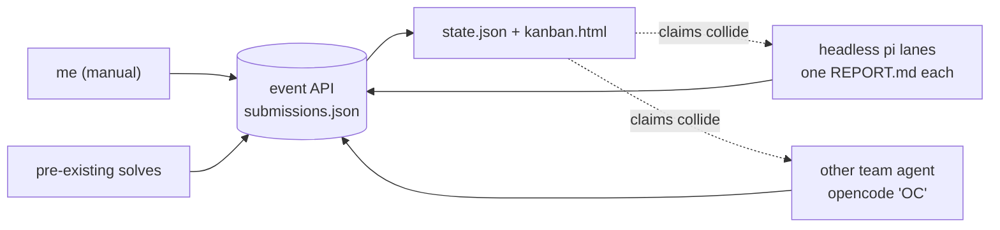

# Caveats, cost and dead ends

Everything here comes from the run's own artefacts: lane reports (`lanes/*/REPORT.md`), the hint
capture (`lanes/HINTS.md`), `submissions.json` and the challenge-detail snapshots. Where records
disagree, the disagreement is shown instead of smoothed over. Board state at handover was
**91 / 240, 10,700 points**; the `FLAGS.md` registry was last rebuilt mid-run and still says
`50 / 240, 3450 pts` — the API snapshot wins wherever they disagree.

## 1. Attribution: three writers, one board

Two workers shared the board; a third category of solves pre-dated both. Every "who solved it"
claim below is a reconstruction, not a submission receipt.

| Writer | Reliably closed | In 03-solved-challenges.md |
|---|---|---|
| me (manual) | T01–T04 desks, pivot build-out | `me (manual)` |
| headless pi lanes | K02.1/2, K09.3/4, K13, K14.1, K17.1, K21, K23, K24.1, W01.1, W03.1 | `pi lane K##` |
| other team agent (OC) | K13.4, K14.1/2, K16.1/2 per `HANDOVER.md` §8 | mostly `team agent` |
| pre-existing | T01.1–T01.3, K01, K03, K04, W02.1/2 | `team agent` |

Mis-attributions, kept visible on purpose:

- **K02.3 `FLAG{12791115ad005ed7}`** was submitted by lane K02 (verified with `submit.py`,
  handover `state=success`), yet the row says `pi lane K09` because K09 later found the same
  constant at `/opt/fieldkest/ci.py:537`.
- **K24.1 `FLAG{664724eb7d7073e9}`** is credited to `pi lane K23`; lane K24's own report still
  reads "no flags yet" — K23 harvested the value and submitted it.
- **K13.4** — "a concurrent agent on the same lane submitted it seconds before this pass could"
  (`lanes/k13/REPORT.md`); that report proves reachability, not first submit.
- **K14.2 / K16.1 / K16.2** appear as `team agent` although `HANDOVER.md` §8 lists them in the OC
  session log — those submits never went through this session's `submit.py`.
- **W02.1/W02.2** closed as `team agent` while lane W02 still said "just started. No flags
  submitted yet" — a claims collision, not a solving lane. Same for K11.1/K11.3 against lane
  K11's "(none yet)", after it had bought three K11.1 hints.

Structural reason: `submissions.json` carries challenge, correctness, points, attempt number and
timestamp **but no flag text**, and `FLAGS.md` was rebuilt only twice — any card submitted by the
other worker is permanently unattributable from our data.

## 2. Hint spend: 42 hints, 770 points forfeited

Recorded total: **42 hint unlocks, 770 points forfeited** (~7 % of the final 10,700). Penalties
escalate by hint order — the snapshots show **10, 20, 30** points charged on top of an unlock
cost (`next_hint_cost: 5` on K02.1 against a first-hint penalty of 10). The per-card snapshot
(183 cards) accounts for 22 of the 42 unlocks and **410** of the 770:

| Card | Cost | Hints | Outcome |
|---|---|---|---|
| K11.1 Where the policy begins | 60 | 3 / 3 | solved — by the other worker |
| K25.1 A customer with a history | 60 | 3 / 3 | **never solved** |
| W01.1 The customer's copy | 60 | 3 / 3 | solved (lane W01D) |
| W01.2 The planner's unfinished handover | 60 | 3 / 3 | not solved by that lane |
| W17.1 The reservoir's present tense | 60 | 3 / 3 | not solved here |
| W17.2 The mode the plant is in | 60 | 3 / 3 | not solved here |
| W17.3 The instrument in the note | 30 | 2 / 3 | not solved here |
| K11.2 Learn its instructions | 10 | 1 / 3 | not solved here |
| K25.2 Which ARWC is current | 10 | 1 / 3 | **never solved** |
| *(20 further unlocks)* | 360 | — | per-card provenance not recorded |

The hints bought references, not access: W01's Nextcloud name and W17's plant layout (FUXA at
`hmi.arwc.test`, OPC UA `opc.tcp://plc:4840/arwc`, historian tables on the OT workstation) never
became a session, and `lanes/HINTS.md` is itself stale — the live API held more unlocked hint text
than the file. Net: 70 points into two K25 cards that stayed unsolved, 60 into a K11 card the
other worker closed independently. Guard-rail added mid-run (`hints.py`), matched by "**DO NOT
UNLOCK HINTS**" in every brief: `if True:  # HINTS DISABLED by operator` → refuses without `--force`.

## 3. Wrong attempts: ~426 submissions that were not the answer

| Metric | Value |
|---|---|
| Submissions recorded | 472 |
| Correct | 46 |
| Incorrect | **426** (≈90 %) |
| Highest attempt number on one card | 8 |
| Worst cards / lane | K02.1 (7 wrong), K03.1 / K03.2 / K04.1 / K04.2 (5 each); W03.2 ~17 attempts, one micro lane added 3 rejects |

Guessing is bad here for three separate reasons:

1. **Attempts are the scarce resource.** Details report `attempt_limit_mode: "lockout"` — tries
   deplete per card and a card can be lost for the rest of the event. The K23 lane inherited
   cards that had "already burned 3 wrong guesses … live API reset attempts (attempt 4 = correct)".
2. **There is nothing to learn from the record.** Wrong submits return only correct/incorrect,
   never the expected text, so 426 incorrect rows are barren data — a guessed 16-hex value is not a
   partial answer.
3. **Most wrong answers were real flags for the wrong card.** W03.2's three rejects were
   `FLAG{8e5eb57412212e11}` (diagnostics deliver receipt), `FLAG{f77bdbb3436a8bab}` (package PUT)
   and `FLAG{7365629ef50739be}` (INSP-2047 trace re-read after deliver — the trace that had
   carried W03.1's flag). Correct evidence, wrong card, card burned anyway.

Working rule: "submit only a flag you have literally read out of a response"
(`lanes/micro/*/BRIEF.md`), plus "`submit.py` burns an attempt on a wrong flag. Establish values
from evidence first." (`HANDOVER.md` §6.7).

## 4. Two flags found, never attributed

Both were read verbatim from live responses in the ARWC support-diagnostics flow and never
accepted on any card.

| Flag | Where it was literally read | Status |
|---|---|---|
| `FLAG{d58c860051957082}` | `POST support.keplerops.test:8443/api/customers/TEN-ARWC-047/diagnostics` with `{"connector_revision":"FLK-7.4.2"}` — returned in the **job draft**, and again on every `GET /api/diagnostics/{job}` | Never submitted; the lane moved to packaged/delivered states and exhausted W03.2 elsewhere |
| `FLAG{870a03c573511895}` | `GET delivery.keplerops.test:8443/api/package-meta/fieldlink-connector` — the legacy 6.9.8 **`deprecated` field**, retained for maintained installations | Never submitted; no card's evidence is the deprecation field |

The source report marks both "do not resubmit blindly": that flow emits four flag-shaped values
and only one belongs to W03.2 — exactly the trap in §3. Related loose end in `FLAGS.md`:
`FLAG{2e184cd91352e573}` (workbench git history, `04176f3:handover.md`) belongs to one of
T01.1/T01.2, but the row mapping was never confirmed.

## 5. Hard dead ends

Walls, not unfinished puzzles — each cost real time and produced no flag.

| Dead end | What was tried | Why it closed |
|---|---|---|
| **ARWC relay channel identity** (`connector.arwc.test`, `10.77.60.20`) | Staff mTLS certs for `evan.calderoux` / `maya`; SPNEGO with the delegated ccache; all five `/api/fieldlink/*` routes; 43k-word raft plus curated sweep (~130k requests); vhost and DNS brute; `10.77.60.0/24`–`/64` sweep | Only `packages/poll`, `packages/{v}/activate`, `packages/{v}/receipt`, `rehearsals/rollback` and `diagnostics` exist, and every one answers `403 channel_identity_denied`. The identity is presumably ARWC-issued, not a KeplerOps staff identity — best pointer is the `maintenance_access` SSH key (`user fieldlink @ connector.arwc.test`) in the diagnostics deliver receipt |
| **sshd `PermitOpen`** on `rowan-dev` | `ssh -D`, dynamic forward, alternate binds | sshd is `AllowTcpForwarding local` + `PermitOpen 127.0.0.1:13389`; `-D` dies with `administratively prohibited`. The workaround that held all run: `socks5.py` relay on `:13389` + `ssh -N -L 0.0.0.0:1080:127.0.0.1:13389` in two supervised tmux sessions |
| **`/tmp` on `rowan-dev`** | Bulk `git clone` of the connector repos for byte-exact fixture work | 64 MB tmpfs; the clones filled it and had to be cleaned. Large work belongs on the range box or in streamed reads |
| **Kubernetes SA has no resource perms** | `SelfSubjectRulesReview` for `rowan-workspace`, `svc-fieldlink-workload`, `svc-fieldlink-export` | `rowan-workspace` can only self-review; the workload SA has `get` on two ConfigMaps (`bld-1842`, `trust-flx-04`); the export SA reaches `role-export-access`, `exp-2841-definition`, `cronjobs/sched-2841`, `jobs`. Secrets, pods and pod logs are denied to all three — exactly what blocked K16.3/K16.4, whose run job prints `$STARTUP_TOKEN` / `$HANDOVER_TOKEN` |

Supporting walls: `objects.keplerops.test` STS rejects the k8s JWTs (`no identity provider
registered for issuer`) and retained collections in `fieldlink-exports` are not listable; `psql
service=fieldlink` reads only `export.partition_bindings` (`permission denied for schema
support`); AnythingLLM chat is unusable (every workspace is `chatMode:"automatic"`);
`10.77.51.60` accepts the support bearer but exposes no route; staff managed-identity answers
`managed_identity_denied` for every service id.

## 6. What a future run should do differently

1. **Separate evidence from submission.** One writer submits and records `flag → card` at submit
   time; `submissions.json` carries no flag text, so otherwise every cross-lane solve stays a guess.
2. **Never buy hints.** 770 points bought no access; 70 went to two cards that stayed unsolved.
   Read the published client document instead.
3. **Fetch `/.well-known/fieldkest-client` before probing.** The route map that unlocked the last
   third of the event was published by the services themselves; the T02 lane's win came from
   reading a markdown index "instead of guessing".
4. **Don't chase `connector.arwc.test`.** The working ARWC ingress is `delivery.keplerops.test:8443`
   and `support.keplerops.test:8443`; the relay wants an identity that is not in KeplerOps' own CA.
5. **Prove the pivot in one command, then prefer `rowan-dev` directly.** Relay `:13389` + `-L 1080`,
   then a `curl --socks5-hostname … /` 200 check. `rowan-dev` routes to `10.77.0.0/16` natively and
   is far cheaper than every command through `box.py` (~8 s round trip).
6. **Two to three concurrent lanes, no more.** Ten-plus lanes triggered `429 / Request aborted` and
   killed the fleet; the model provider, not RAM, is the limit.
7. **One writer per lane, claims before contact.** Register cards in `lanes/state.json` with the
   lane tag before touching a target, and never run `set_active.py` mid-session — it rebuilds
   `in_progress` from chapter codes and erases the other worker's claims. W02 and K24.1 are the cost.
8. **Write `REPORT.md` early and harvest it, not `run.log`.** Neighbouring lanes recovered flags
   from reports their owners had abandoned (K23→K24.1, K09→K02.3).
9. **Map flags to cards before submitting from a multi-flag flow**, and stop after two rejects to
   re-derive. Two diagnostics-chain values are still unattributed.
