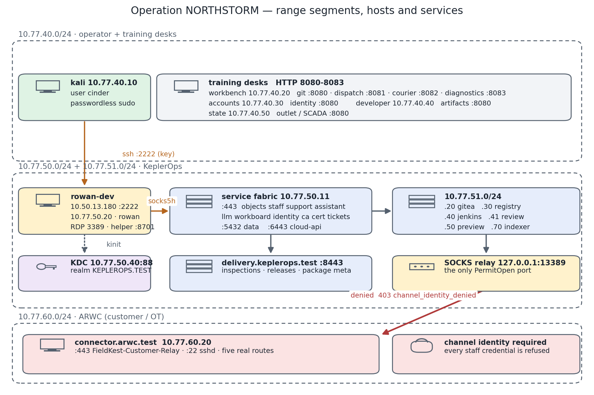

# T01.2 — Off the menu

> **Category:** 1. Training · **Points:** 50 · **Difficulty:** easy
> **Solved by:** team agent

## Where this happens



Primary service for this card: `workbench.training`. The map shows which segment it sits in and how
traffic reaches it (browser terminal → kali → rowan-dev → SOCKS relay → 10.77.x).

## At a glance

| | |
|---|---|
| **Vulnerability / bug class** | Unlinked-but-served content — the desk's navigation ("menu") lists fewer items than the service publishes; retired entries stay reachable by direct request |
| **Tools** | `curl`, a link/manifest diff, targeted path probing |
| **Attack surface** | Workbench desk `http://workbench.training:8080/` (10.77.40.20), plus its `:8081` dispatch desk and `:8082` courier API |
| **Prerequisite** | Nothing beyond reachability of the training network |
| **Flag** | accepted, value not recorded |

**What you are about to read:** why "not in the menu" is not "not there", and how to prove it
— collect every path the desk advertises (index, HTML, client manifest), then request the
ones nobody links. The same recipe finds hidden admin pages, retired documents and debug
routes.

## Objective

> Retrieve the desk's content that is not listed on its front page.

The workbench is a small mock intranet: a markdown index on `:8080`, a dispatch notice surface
and a courier API. The index presents the tasks a courier is supposed to do; the card asks for
something that exists but was taken off that menu — reachable by reading the desk's own client
metadata rather than by clicking.

## Background you need

- **The menu is application logic, not access control.** Navigation is rendered from a list a
  developer maintains; the route table, the document root and the client configuration are
  separate artefacts that drift apart when an entry is retired.
- **Indices leak other indices.** A front page that says the current *and retired* content
  indexes are declared by `/site.webmanifest` is telling you where the publisher keeps its
  page list — and clients need that list, so it is served, not hidden. Retirement is usually
  a de-link, not a deletion: the file stays on disk "for compatibility".

## Walkthrough

### 1. Recon — enumerate what the desk says about itself

```bash
W=http://workbench.training:8080
curl -sS "$W/" | tee /tmp/menu.md | head -40
grep -oE '(href|src)="[^"]*"' /tmp/menu.md | sort -u > /tmp/linked.txt
curl -sS -i "$W/site.webmanifest"      # client content declaration
```

The delivery notice on the dispatch surface states the convention outright
(`:8081/notice-DL-204.md`):

> Courier CR-17 is assigned three sealed rehearsal parcels for the Cinder receiving desk.
> The public notice does not include the bay amendment. Offline clients load the current and
> retired content indexes declared by `/site.webmanifest`.

Two useful statements: there is a **bay amendment** the public notice omits, and the
authoritative list of current *and retired* content is a manifest.

### 2. Finding the flaw — diff the manifest against the menu

```bash
curl -sS "$W/site.webmanifest" | grep -oE '"/[^"]*"' | tr -d '"' | sort -u > /tmp/declared.txt
comm -23 /tmp/declared.txt \
  <(grep -oE '"[^"]*/[^"]*"' /tmp/linked.txt | tr -d '"' | sort -u)
```

Anything declared but unlinked is a candidate: the publisher calls it content, the UI calls
it gone. Sweep the sibling ports too (`:8081` dispatch desk, `:8082` courier API) — they
serve the same delivery from other angles.

### 3. Exploitation — request the unlisted path directly

```bash
for p in $(cat /tmp/candidates.txt); do
  printf '%-40s ' "$p"
  curl -sS -o /tmp/out -w '%{http_code} %{size_download}\n' "$W$p"
  head -c 300 /tmp/out; echo
done
```

The signal is a `200` with real content for a path the menu does not offer — not `404` (no
such route) and not `403` (route exists, authorization applies).

### 4. Getting the flag

The accepted value came from the content behind that unlisted entry. The card record keeps no
response body, so it is not reproduced here: the body you get is the source of truth.

## Why this works (the vulnerability explained)

The desk keeps three representations of "what exists": the **menu** (rendered links, UI code),
the **client manifest** (current + retired, publisher config) and the **route table /
document root** (server). Only the first was updated on retirement, so the only barrier is the
absence of a hyperlink — and hyperlinks are not access control. A manifest reduces "typing
URLs" to "reading a JSON file". Correct: remove the file from the served tree (or gate it with
an authorization check) and generate the manifest from the same source as the authorization
decisions.

## Detection and fix

- **Detection:** `200`s for document-like paths that never appear in the menu, from a client
  that did not walk the index; a burst of sequential document requests on a tiny desk. In CI,
  diff the document root against the menu.
- **Fix:** retire by removal, not de-linking — delete the file or gate it like private
  content. Never publish the location of sensitive documents in a client-readable index.

## Notes and dead ends

- Solved by the team agent; the per-card evidence is essentially the challenge listing
  (`solved: true`, 50 points). **The technique is reconstructed** from the desk's published
  conventions — the notice's "current and retired content indexes" sentence and the desk's
  port map — not from a transcript. No response body or flag value is recorded for this card.
- The code above is therefore a reproducible recipe (manifest → diff → direct request), not a
  verbatim transcript; the notice URL is the only verified `curl`.
- `robots.txt` is not the answer on this desk family: it returns `404` on the sibling identity
  desk. Absence of a `Disallow` line is not absence of content.
- Not an authentication bypass — every response is anonymous. The finding is about
  *publication scope*, and the fix is editorial as much as technical.
